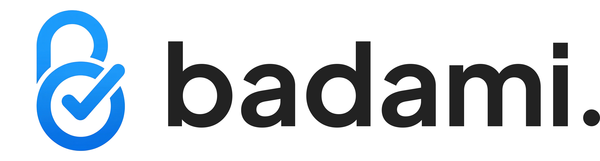

<p align="center">
  
</p>

<p align="center">
  Projects, tasks, planning, servers, database work, and a local PHP stack<br/>
  in one desktop app. macOS, Windows, and Linux.
</p>

<p align="center">
  <a href="https://khalidinsan.github.io/badami/"><strong>Website and docs</strong></a>
  &nbsp;·&nbsp;
  <a href="https://github.com/khalidinsan/badami/releases/latest">Download</a>
  &nbsp;·&nbsp;
  <a href="https://github.com/khalidinsan/badami/issues">Issues</a>
</p>

---

## The name

**Badami** is a Sundanese verb. It means to deliberate: to sit with something that
matters and talk it through until there is agreement. In Indonesian the usual
translation is *bermusyawarah*.

It is a *loma* word, the register used between peers rather than the formal one kept
for elders, and its polite counterpart is *badanten*. The
[Sundanese Wiktionary entry](https://su.wiktionary.org/wiki/badami) cites *Kamus Basa
Sunda* by R.A. Danadibrata, and the 1982 *Kamus Bahasa Sunda-Indonesia* (Depdikbud)
lists it as *berunding*, *musyawarah*, *berembuk*, with *dami* meaning to agree.

That is the claim the app makes about itself: Badami does not decide anything on your
behalf, and it does not tell you what your work is. It keeps the material in one place
so the thinking stays yours.

---

## Install

Download the installer for your platform from
**[the latest release](https://github.com/khalidinsan/badami/releases/latest)**.

| Platform | Asset |
|---|---|
| macOS (Apple Silicon) | `badami_<version>_aarch64.dmg` |
| Windows | `badami_<version>_x64-setup.exe` or `.msi` |
| Linux | `.AppImage`, `.deb`, or `.rpm` |

Builds are signed for the in-app updater but not Apple-notarized, so macOS may block
the first launch. Clear the quarantine flag once:

```bash
xattr -cr /Applications/badami.app
open /Applications/badami.app
```

Full walkthrough: **[Install](https://khalidinsan.github.io/badami/docs/install.html)**.

## Documentation

| Page | Covers |
|---|---|
| [Overview](https://khalidinsan.github.io/badami/docs/) | What is in the app, and where your data lives |
| [Install](https://khalidinsan.github.io/badami/docs/install.html) | Per-platform install and updates |
| [Local Dev](https://khalidinsan.github.io/badami/docs/local-dev.html) | The local PHP stack: runtime, sites, HTTPS, DNS, database, safety |
| [Development](https://khalidinsan.github.io/badami/docs/development.html) | Toolchain, running from source, tests, releases |
| [Architecture](https://khalidinsan.github.io/badami/docs/architecture.html) | Repository layout, tech stack, data flow |

## Development

```bash
git clone https://github.com/khalidinsan/badami.git
cd badami
npm install
npm run tauri dev
```

The first run compiles the Rust crates and takes a few minutes. Requires Node.js 20+
and Rust stable 1.77+. See
[Development](https://khalidinsan.github.io/badami/docs/development.html) for the
per-platform packages.

## Local Dev

Badami serves local `*.test` sites from nginx, PHP-FPM, MariaDB, Redis, and dnsmasq
binaries that it installs and manages itself, so nothing else has to be on the machine.
Binaries live under `runtime/<role>/<version>/` with a SHA-256 manifest, and the
database under `data/mariadb`.

See [Local Dev](https://khalidinsan.github.io/badami/docs/local-dev.html) for the full
picture, including how a datadir is moved and how privileged pieces are installed and
removed.

## Contributing

Issues and pull requests are welcome at
[github.com/khalidinsan/badami](https://github.com/khalidinsan/badami).

## License

MIT
